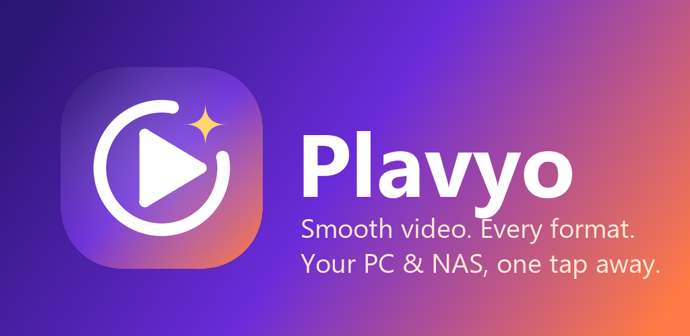

# Plavyo

**A fast, smooth video player for Android**, for local files and your home network in one app.
Free, with no ads, no tracking and no accounts.

### ⬇️ [Download the latest APK](https://github.com/unreal-ahsan/Plavyo/releases/latest)

## Features

- Plays almost any format: MKV, MP4, AVI, MOV, WebM, TS, HEVC/H.265, AV1, VP9 and more.
- Hardware decoding with automatic software fallback.
- **Network streaming from SMB (Windows / NAS shares), FTP and WebDAV.**
  - **Scan** your Wi-Fi to find computers and NAS drives automatically.
  - Connect with just the server's address: Plavyo lists every shared folder for you.
  - Smooth playback of large, high-bitrate files over Wi-Fi with fast seeking.
- **Enhance**: one tap for richer colours and smoother gradients.
- **Private folder**: hide videos from your gallery and other apps behind a PIN.
- Subtitles: embedded, external, and auto-loaded from the same folder (also on network shares).
  Drag subtitles up/down, pinch to resize, swipe for the next/previous line.
- Gestures for seeking, volume and brightness; playback speed; picture-in-picture.
- Material You design with light and dark themes.

## Which APK should I download?

| File | For |
|---|---|
| `Plavyo-…-arm64-v8a.apk` | Almost all modern phones (recommended) |
| `Plavyo-…-armeabi-v7a.apk` | Older 32-bit phones |
| `Plavyo-…-universal.apk` | Works on every device (larger download) |
| `Plavyo-…-x86_64.apk` / `x86.apk` | Emulators and Intel/AMD Android devices |

Not sure? Pick **universal**.

## Connecting to your PC or NAS

1. Open the **Network** tab and tap **Scan**.
2. Tap your computer or NAS in the list.
3. Enter your Windows/NAS username and password (or tick *Anonymous/Guest*) and tap **Save**.
   Plavyo saves the connection and connects right away. Tap it to browse your shared folders.

Not found by the scan? Tap **Add Connection**, choose **SMB**, enter the computer's IP address
(for example `192.168.1.10`) and leave **Path** as `/`.

## Privacy

Plavyo collects nothing. See [PRIVACY.md](PRIVACY.md).

## License

Plavyo is free to download and use, but it is **not open source**. See [LICENSE.md](LICENSE.md).
Redistribution and any use for training or evaluating AI / machine-learning models are
prohibited.

Plavyo is built on open-source software, including mpvEx (Apache-2.0), mpv and FFmpeg
(LGPL-2.1+). See [THIRD_PARTY_NOTICES.md](THIRD_PARTY_NOTICES.md).
